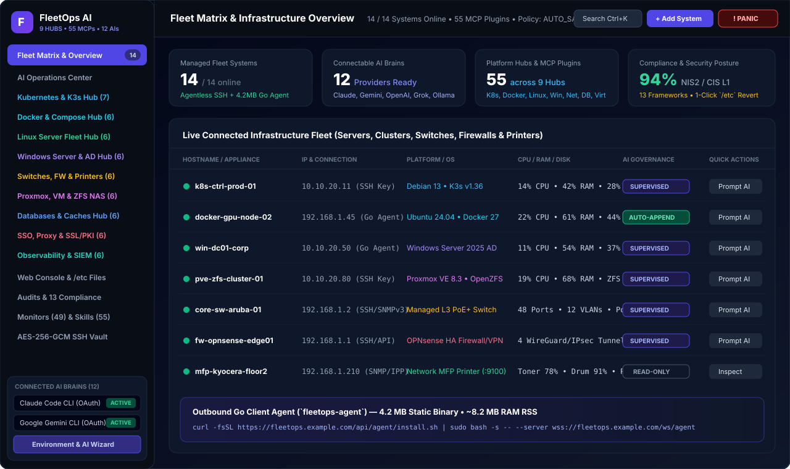
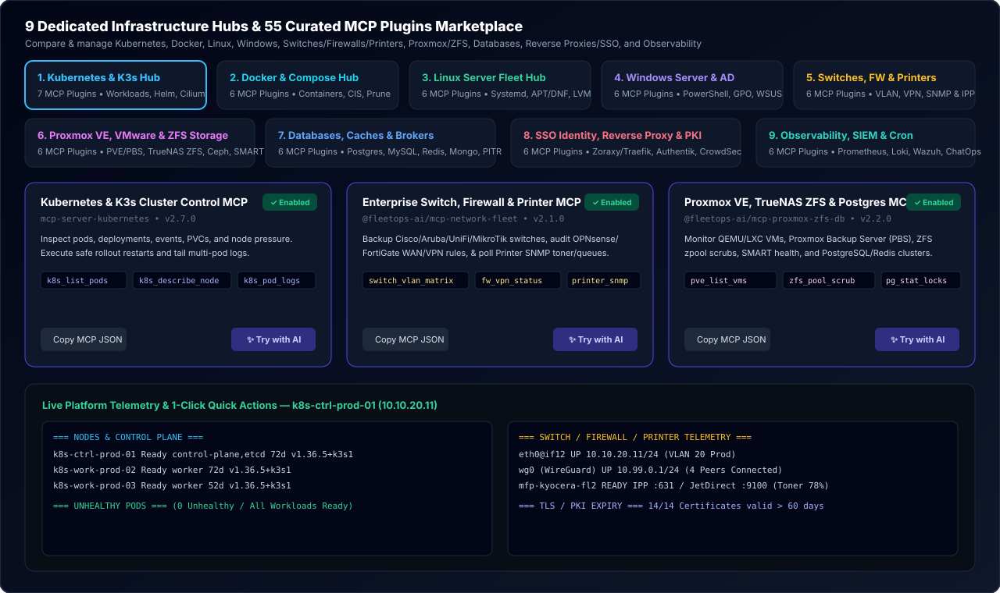
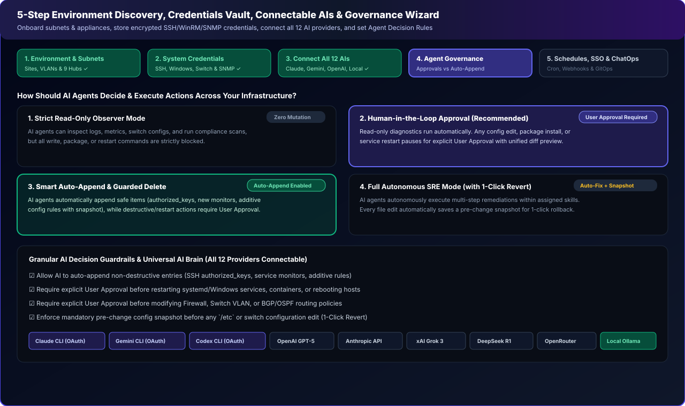
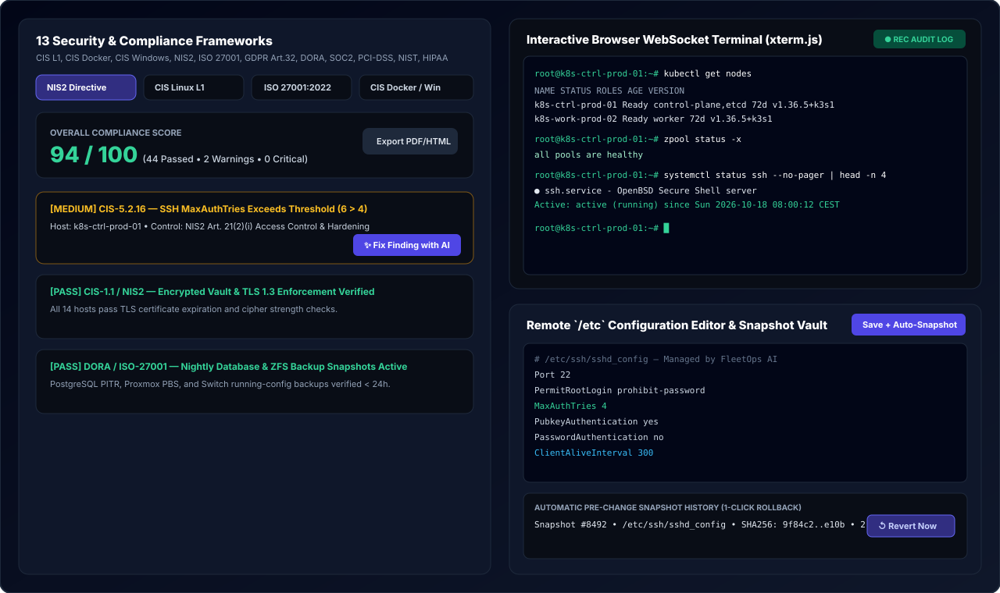

# FleetOps AI Wiki

Welcome to the **FleetOps AI** documentation and knowledge base.

FleetOps AI is an enterprise-grade, self-hosted AI Fleet & Infrastructure Operations Platform that lets you operate Linux servers, Windows nodes, Kubernetes clusters, Docker hosts, network switches, firewalls, and network printers using your existing AI subscriptions (Anthropic Claude, Google Gemini, OpenAI Codex), cloud APIs, or sovereign air-gapped LLMs (Ollama, llama.cpp, vLLM).

---

## 📚 Table of Contents

- [System Architecture](Architecture.md) — Hybrid connectivity (Agentless SSH + Outbound Go WebSocket Agent), AES-256-GCM Vault, Keystore, and built-in MCP server.
- [Setup Wizard, Discovery & Credentials](Setup-Wizard-and-Credentials.md) — 5-step onboarding wizard, TCP subnet prober, multiple SNMP communities pool (v1/v2c/v3), and multi-profile Linux SSH & Windows/Switch credentials.
- [AI Brains & Decision Governance](AI-Brains-and-Governance.md) — 12 supported AI providers, Claude & Gemini CLI subscription OAuth profiles, 4 decision tiers (Read-Only to Autonomous SRE), and `/etc` pre-change snapshots with 1-click revert.
- [Platform Hubs & 55 MCP Catalog](Platform-Hubs-and-MCP-Catalog.md) — Deep-dive into the 9 dedicated infrastructure hubs and the 55 curated Model Context Protocol plugins.
- [Outbound Go Client Agent](Agent-Go-Deployment.md) — Zero-inbound-port pure Go static client agent (`fleetops-agent`) for Linux and Windows.
- [Compliance Frameworks & Runbooks](Compliance-and-Runbooks.md) — 13 compliance benchmarks (CIS Levels 1 & 2, NIS2, ISO 27001, DORA, GDPR Art. 32, SOC2), 1-click AI remediation, scheduled cron runbooks, and ChatOps webhooks.

---

## ⚡ Quick Links & UI Walkthrough

| Screenshot / Feature | Description |
| :--- | :--- |
|  | **Live Fleet Operations Center**: Real-time status of all Linux, Windows, Kubernetes, Docker, and Network nodes. |
|  | **Universal AI Chat & Execution**: Interact with Claude, Gemini, or local models to diagnose, audit, and patch systems. |
|  | **9 Specialized Infrastructure Hubs**: Dedicated workspaces for K8s, Docker, Linux, Windows, Switches, DBs, Storage, SSO & SIEM. |
|  | **5-Step Setup Wizard**: Automated subnet discovery, multiple SNMP communities, and multi-profile Linux SSH credentials. |
|  | **13 Compliance Frameworks & Web Terminal**: CIS / NIS2 / ISO audits with 1-click AI remediation and interactive SSH/SFTP session recording. |
